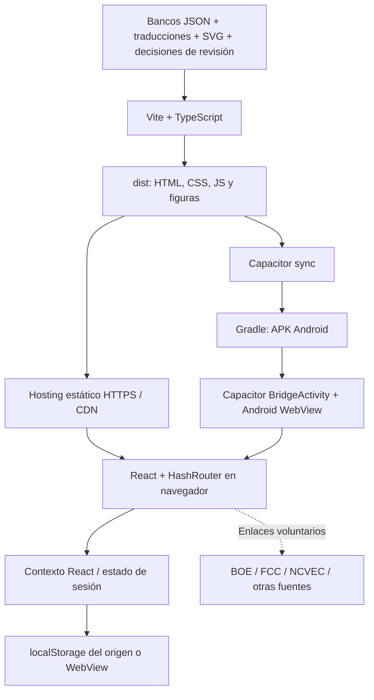

# Guía técnica y de despliegue

**EA5KAO Ham Exam Prep · Autor: Anatol EA5KAO**

Documento: 2026-10-18 · [English](TECHNICAL-GUIDE.en.md) · [Resultados verificados](VALIDACION.es.md)

## 1. Alcance y estado real

Aplicación educativa para web y Android. Estados Unidos incluye Technician,
General y Amateur Extra en inglés y español. España incluye Técnica y
Reglamentación con preguntas y explicaciones en español; no hay traducción inglesa
del banco español en esta entrega. El idioma de la interfaz no cambia esa limitación.
No administra exámenes oficiales, no emite certificados HAREC y no tiene
cuentas, API propia, base de datos remota, pagos ni sincronización entre dispositivos.

Los bancos USA suman 1.431 preguntas (409/423/599). España tiene 1.094 preguntas
(578 técnicas y 516 de reglamentación), 73 SVG y 46 preguntas pendientes excluidas
de los simulacros: 578/470 elegibles. No se certifica todo el contenido como vigente.

## 2. Arquitectura



### 2.1 Componentes y responsabilidades

| Componente | Responsabilidad y límites |
|---|---|
| `src/App.tsx` | Contexto de estado y rutas `HashRouter`; un mismo árbol React en web y Android |
| `src/pages/HomePage.tsx` | Selector de país y entrada USA |
| `src/pages/LevelPage.tsx`, `StudyPage.tsx`, `PracticePage.tsx`, `ExamPage.tsx` | Selección y modos USA |
| `src/pages/SpainPage.tsx` | Importación local, estudio y dos pruebas españolas independientes |
| `src/lib/pools.ts` | Bancos USA y traducciones cargados de forma anticipada; caché de mezcla |
| `src/lib/exam.ts`, `selection.ts` | Aleatoriedad, selección por grupo y calificación USA |
| `src/lib/spain.ts` | Esquema, validación, deduplicación, mezcla por ID, opciones y exámenes España |
| `src/lib/explanations.ts`, `calculation-explanations.ts` | Fundamentos bilingües y desarrollos individuales USA |
| `src/lib/comics.ts`, `src/components/QuestionComic.tsx` | Episodios Los DamWatts generados por pregunta, viñetas SVG originales y marca de agua; solo tras revelar o entregar. Véase [alcance](DAMWATTS.md) |
| `src/lib/progress.ts` | Estado USA, estadísticas e historial local |
| `scripts/import-*.mjs`, `spain-review.mjs` | Conversión, trazabilidad, revisión y reglas explícitas sobre datos |
| `public/figures/` | Recursos estáticos empaquetados; no se descargan bajo demanda de un tercero |
| `android/` | Contenedor nativo Capacitor, manifest, iconos y Gradle |

### 2.2 Rutas y flujo de ejecución

1. El servidor entrega `index.html` y los assets del build.
2. React restaura preferencias y progreso USA desde `hamprep.v1`.
3. `/#/` permite elegir país; `/#/usa` muestra niveles y `/#/spain` el módulo español.
4. USA usa `/#/level/technician`, `/general` o `/extra`, con sufijos
   `/study`, `/practice` y `/exam`. Los grupos viajan en la consulta de la ruta hash.
5. España mezcla el banco incluido con `hamprep.spain.questions.v1`.
   La versión empaquetada prevalece para sus IDs; no resucitan claves antiguas.
6. Se crea una sesión en memoria; al responder se revela la explicación cuando
   corresponde. En exámenes no aparecen pistas antes de entregar.
7. USA guarda estadísticas e historial; España no guarda resultados ni una prueba
   en curso. Recargar abandona el intento español.

`base: './'` y `HashRouter` permiten subdirectorios y WebView sin redirecciones
del servidor para rutas internas. No usar `file://` como despliegue web fiable:
servir el contenido por HTTP(S).

### 2.3 Reglas del dominio

| Prueba | Selección | Aprobado |
|---|---|---|
| Technician | 35, una por cada grupo oficial | 26 |
| General | 35, una por cada grupo oficial | 26 |
| Extra | 50, una por cada grupo oficial | 37 |
| USA, grupos seleccionados | Una por grupo elegido, o todo lo seleccionado | `ceil(total × 0,74)` |
| España Técnica | 30 distintas sin revisión pendiente | 15; 45 minutos |
| España Reglamentación | 30 distintas sin revisión pendiente | 15; 45 minutos |

España exige superar ambas partes; las notas no se compensan y los fallos no
restan. Cada parte tiene su propio temporizador. Los filtros temáticos españoles
solo afectan al estudio, no a la simulación. Las opciones de texto se mezclan
recalculando la clave; las opciones gráficas/fijas mantienen el orden.

USA dispone de práctica, flashcards y vista de solo respuestas correctas.
Su criterio de dominio implementado es: último intento acertado y precisión
acumulada >=75 %, **no dos aciertos consecutivos**. El historial conserva
los últimos 50 exámenes USA.

### 2.4 Persistencia y aislamiento

- `localStorage` es local al origen (esquema, host y puerto), perfil y dispositivo.
- Web y Android no comparten automáticamente datos, ni tampoco dos dominios web.
- Borrar datos del navegador, desinstalar o cambiar origen puede perder progreso.
- El JSON importado español se guarda localmente; no carga imágenes nuevas.
- Los errores de importación se muestran y una importación inválida no se guarda.
- Limitación existente: la persistencia de progreso USA captura errores de almacenamiento
  sin informar al alumno; no prometer que siempre se guardará ni un backup integrado.
- No hay cifrado propio, autenticación ni almacenamiento apto para secretos.
- Android permite backup en el manifest; el comportamiento efectivo depende del
  dispositivo y del sistema. No es un mecanismo probado de recuperación.

### 2.5 Funcionamiento sin conexión

Android empaqueta JS, bancos e imágenes y puede estudiarse sin red tras instalarlo.
Los enlaces a BOE/FCC/otras webs sí requieren conexión. La web incluye un
`manifest.webmanifest` básico, pero **no implementa service worker ni precaché
garantizada**. No se ha verificado su instalación como PWA. Una pestaña ya cargada
puede seguir funcionando, pero cerrar y reabrir sin red no está garantizado.
La caché HTTP del navegador no sustituye esa garantía.

## 3. Requisitos técnicos

### 3.1 Construcción y pruebas

| Elemento | Versión/condición |
|---|---|
| Git | Cliente con HTTPS y acceso al repositorio |
| Node.js | 22.23.3 usado en la validación y fijado en CI; usar Node 22 compatible |
| npm | El incluido con Node 22; `npm ci` utiliza `package-lock.json` |
| Frontend | React 19, React Router 7, Vite 8, TypeScript 6 |
| Pruebas/lint | Vitest 5 y oxlint; sin herramientas de carga adicionales |
| Android | Capacitor 8.5, JDK **21**, Gradle wrapper 8.14.3, AGP 8.13.0 |
| SDK | `platforms;android-36`, `build-tools;35.0.0`, `platform-tools` |
| SO | Windows para el helper APK PowerShell; Linux/macOS pueden usar Gradle manualmente |
| Conectividad inicial | npm, repositorios Gradle/Maven/Google y GitHub |

Presupuesto recomendado para construir, no mínimo certificado: 4 núcleos,
8 GB RAM y 15 GB libres para cachés/SDK; más si se usa emulador. No se ha realizado
una prueba sistemática del equipo mínimo. JDK 17 o Java 8 no compilan el código
Java 21 de Capacitor 8 en este proyecto.

### 3.2 Ejecución

Web: hosting de archivos estáticos HTTPS; navegador moderno con JavaScript,
SVG y `localStorage`. No necesita Node, Java, PHP, SQL, contenedores o API en
producción. RAM y CPU se consumen sobre todo en el dispositivo del alumno.

Android: `minSdk=24` (Android 7.0), `targetSdk=36`, WebView actualizado,
espacio para APK y datos. El manifest solicita `INTERNET` para funcionalidades
y enlaces web; no hay plugins propios de cámara, localización o cuentas.
Compatibilidad declarada no equivale a prueba física en todas las versiones.

## 4. Preparación desde cero

```powershell
git clone https://github.com/Brico-Hams/exam.git
Set-Location exam
node --version
npm --version
npm ci
npm test
npm run lint
npm run build:public
```

No ejecutar `npm update` como paso de despliegue: cambia las dependencias.
Guardar cualquier modificación del lockfile en un cambio revisado.

### 4.1 Build público frente a build local

- `npm run build` conserva la opción local de traducciones GLAARG autorizadas.
- `npm run build:public` excluye **siempre** `src/data/i18n/es-glaarg/`, aunque
  exista localmente, y usa la traducción propia completa.
- `npm run android:sync:public` aplica lo mismo a la APK.
- Los PDF y traducciones GLAARG no se incluyen en Git ni deben publicarse por
  accidente dentro de un JS. Un archivo ignorado por Git puede entrar en un build
  si no se controla explícitamente.
- BricoHams se atribuye bajo CC BY-SA 4.0; SVG y notas se conservan. La autoría
  de la aplicación es Anatol EA5KAO, no la de todos los materiales de terceros.

### 4.2 Desarrollo

```powershell
npm run dev -- --host 127.0.0.1
```

No exponer Vite a Internet como servicio de producción. Para comprobar el build:

```powershell
npm run build:public
npm run preview -- --host 127.0.0.1 --port 4183 --strictPort
```

## 5. Despliegue web paso a paso

### 5.1 GitHub Pages, manual y controlado

1. Tener permisos de administración y un plan/visibilidad que permita Pages.
2. En GitHub, **Settings → Pages → Build and deployment → Source: GitHub Actions**.
3. Abrir **Actions → Deploy web to GitHub Pages → Run workflow** sobre `main`.
4. El workflow instala desde el lockfile, prueba, hace lint y compila en modo público.
5. Solo el job de despliegue tiene `pages:write` e `id-token:write`.
6. Aprobar el entorno `github-pages` si tiene protección.
7. Usar la URL real que devuelve el workflow; normalmente
   `https://brico-hams.github.io/exam/`, pero no darla por activa antes de comprobarlo.
8. Abrir `/`, `/#/usa`, `/#/spain`, General y Extra; cargar una figura y un simulacro.
9. Registrar commit desplegado, URL, fecha y prueba de aceptación.

Esta entrega configura el workflow; no cambia automáticamente la configuración
de Pages ni presume que el sitio esté publicado. En repositorios privados,
comprobar la visibilidad del sitio publicado antes de activarlo.

### 5.2 Cualquier hosting estático

1. Ejecutar pruebas y `npm run build:public`.
2. Subir **el contenido de `dist/`**, incluidas carpetas `assets/` y `figures/`,
   no fuentes, `node_modules`, SDK, keystores o archivos del usuario.
3. Activar HTTPS y MIME correctos: HTML, JavaScript, CSS y `image/svg+xml`.
4. Publicar de forma atómica. No borrar los assets de la versión anterior
   mientras clientes puedan tener su HTML en caché.
5. Para `index.html`, `Cache-Control: no-cache`; para assets con hash,
   `public,max-age=31536000,immutable`; para figuras sin hash, revalidación
   o TTL corto. Aplicar lo mismo al comprimir con gzip/Brotli.
6. No responder `index.html` con 200 al pedir JS/SVG inexistentes: es un fallo
   de contenido, aunque un monitor superficial vea HTTP 200.
7. Probar rutas hash, respuestas y figuras desde la URL final, no solo localhost.
8. Restaurar el artefacto anterior completo para rollback. El progreso del origen
   no se borra por un rollback, pero comprobar compatibilidad de IDs y esquemas.

Cabeceras recomendadas, a adaptar: `X-Content-Type-Options: nosniff`,
`Referrer-Policy: strict-origin-when-cross-origin`; si se usa CSP, probar
scripts, estilos y enlaces antes de imponerla. No copiar una CSP sin validarla.

## 6. APK Android paso a paso

### 6.1 Compilación alojada reproducible

1. Subir a `main` o ejecutar **Actions → Android debug APK → Run workflow**.
2. El runner Windows configura Node 22.23.3 y Temurin JDK 21.
3. Comprueba que el SDK del runner ya tiene aceptada su licencia. Si no, falla:
   el workflow no ejecuta una aceptación automática.
4. Prepara API 36, build-tools 35.0.0 y platform-tools.
5. Ejecuta `npm ci`, tests y lint.
6. `scripts/build-apk.ps1` compila en modo público, sincroniza Capacitor
   y ejecuta `assembleDebug` sin daemon y con dos workers como máximo.
7. Verifica firma con `apksigner`, paquete/SDK con `aapt` y compara por SHA-256
   **cada archivo de `dist/`** con su entrada en `assets/public/` de la APK.
8. Publica un artefacto Actions con APK, `SHA256SUMS.txt`, `build-info.json`,
   manifest inspeccionado y bundle web. Retención: 30 días.
9. Descargar desde una ejecución **correcta**, extraer ZIP y comprobar checksum.
   El artefacto de un repo privado puede requerir sesión GitHub.
10. Conservar una copia del artefacto si se necesita más de 30 días.
    Los APK no se versionan en Git; la receta y los documentos sí.

Para esta entrega, la APK verificada, el checksum y `build-info.json` están además
en la [prerelease de pruebas](https://github.com/Brico-Hams/exam/releases/tag/v1.0.0-debug.20261018),
sin la caducidad de 30 días de Actions. Las compilaciones futuras solo generan
el artefacto; publicar una nueva prerelease es un paso independiente. Hace falta
acceso al repositorio privado. Véase el [informe de validación](VALIDACION.es.md).

No afirmar reproducibilidad **binaria** entre compilaciones: certificado debug,
timestamps y herramientas del runner pueden variar. Se garantiza la receta y la
comparación de assets del build concreto, no un APK idéntico bit a bit.

### 6.2 Compilación local Windows

1. Instalar JDK 21 y Android Studio o Android command-line tools desde sus fuentes
   oficiales. Leer y aceptar personalmente las licencias SDK.
2. En SDK Manager instalar API 36, Build Tools 35.0.0 y Platform Tools.
3. Configurar variables solo en la terminal si no se quiere alterar el equipo:

```powershell
$env:JAVA_HOME = 'C:\ruta\al\jdk-21'
$env:ANDROID_HOME = "$env:LOCALAPPDATA\Android\Sdk"
$env:Path = "$env:JAVA_HOME\bin;$env:ANDROID_HOME\platform-tools;$env:Path"
java -version
javac -version
npm ci
npm run android:apk
```

4. El resultado queda en `artifacts\android\EA5KAO-Ham-Exam-1.0.0-debug.apk`.
5. Comparar `(Get-FileHash ... -Algorithm SHA256).Hash` con `SHA256SUMS.txt`.

El helper espera Windows y `JAVA_HOME` explícito. `-SkipWebBuild` solo es para
diagnóstico con assets ya sincronizados; puede fallar la comparación si están
desactualizados. No usarlo para una entrega normal.

### 6.3 Instalación y aceptación en dispositivo

```powershell
adb devices
adb install -r '.\artifacts\android\EA5KAO-Ham-Exam-1.0.0-debug.apk'
adb shell am start -n com.hamexamprep.app/.MainActivity
```

Alternativa: copiar APK al dispositivo, comprobar origen y habilitar
temporalmente instalación desde esa fuente. No recomendar desactivar protecciones
globales. Probar:

- Inicio por país, idiomas y carga de Technician/General/Extra.
- Práctica, flashcard con respuesta oculta, figura ampliable y clave correcta.
- España: aviso en pendientes, referencia tras revelar, 30 preguntas, reloj
  independiente y aprobado exactamente con 15.
- Modo avión después de instalar: bancos y figuras locales disponibles.
- Rotación, botón Atrás, pantalla pequeña y reanudación desde segundo plano.
- Reinicio de app y persistencia USA; recarga española abandona la sesión.

Una APK debug tiene depuración habilitada y certificado de desarrollo. Dos
compilaciones desde runners distintos pueden tener claves debug distintas.
Si una actualización muestra `INSTALL_FAILED_UPDATE_INCOMPATIBLE`, **no desinstalar
sin salvar datos y autorización del usuario**: desinstalar puede borrar progreso.
Para pruebas persistentes usar una clave estable controlada por el propietario.

### 6.4 Release firmado y Google Play (no realizado)

1. El propietario crea o elige una clave de publicación/Google Play App Signing
   y conserva sus copias seguras fuera del repositorio.
2. Incrementar `versionCode` para cada nueva publicación y alinear `versionName`
   y metadatos con la versión de producto. Hoy Android usa 1/`1.0` y npm `1.0.0`.
3. `npm run android:sync:public`, después `npm run android:open`.
4. **Build → Generate Signed Bundle / APK**, elegir APK o AAB y la clave del
   propietario. No usar certificado debug, contraseñas en argumentos ni archivos
   de firma comprometidos en Git.
5. Verificar firma de release, manifest, assets y comportamiento en dispositivos;
   crear checksum y registrar commit, versión y certificado público.
6. En Play Console completar ficha, privacidad/Data Safety, clasificación,
   derechos de materiales, acceso y pruebas exigidas por la cuenta.
7. Comprobar las políticas y nivel objetivo vigentes en la fecha de publicación.
8. Distribuir primero por canal interno; promover tras aceptación y tener plan
   de recuperación. Un AAB no se instala directamente con `adb install`.

No hay configuración automática de firma release ni AAB publicado en esta entrega.
La existencia de un keystore debug no autoriza a tratarlo como clave de producción.

## 7. Procesos de datos y mantenimiento

### 7.1 USA

1. Verificar vigencia en NCVEC/FCC/ARRL.
2. Revisar `POOLS` en `scripts/import-pools.mjs`; ejecutar `npm run import-pools`.
3. Revisar diferencias, erratas, grupos, claves y rutas de figuras.
4. Actualizar traducciones propias en el mismo orden que las opciones inglesas.
5. `npm run import-glaarg` es local y opcional: no da permiso para redistribuir.
6. Ejecutar pruebas de bancos, traducciones y explicaciones antes del build público.

### 7.2 España

1. Conservar el paquete fuente autorizado y su licencia fuera de Git si procede.
2. Ejecutar `npm run import-bricohams -- "C:\ruta\BricoHams_banco_preguntas"`.
3. El SHA-256 debe coincidir con el paquete revisado; otro paquete falla de forma
   explícita para no aplicar correcciones a ciegas.
4. Revisar cada decisión de `scripts/spain-review.mjs`, fuentes BOE y vigencia.
   No retirar `reviewReason` solo para aumentar cobertura.
5. Regenerar JSON/informe; se conservan originales de las preguntas contrastadas.
6. Validar deduplicación por parte, enunciado, contexto gráfico y respuesta;
   claves contradictorias y IDs reutilizados provocan error.
7. Revisar recuentos, pruebas, licencias y sincronización Android.

Importación desde la pantalla española: confirmar derechos, seleccionar JSON,
validar y guardar localmente. No es una subida al repositorio ni despliegue a
otros alumnos. El esquema completo se documenta en el README raíz.

## 8. Simulación de cargas de trabajo

### 8.1 Qué se mide

La arquitectura no tiene backend de sesiones. La carga remota real es servir
archivos estáticos. El examen y su calificación se ejecutan en el cliente;
crear «usuarios concurrentes» HTTP no simula CPU ni memoria de React/WebView.

`scripts/load-test.mjs` usa Node y `fetch`, sin dependencias nuevas:

- `cold-visit`: HTML, todos los JS/CSS del build y dos figuras españolas,
  secuencialmente por sesión; sin caché de navegador.
- `figure-navigation`: solicita las dos figuras, representando visitas de
  contenido con el JS ya residente; **no simula respuestas ni navegación React**.
- Por defecto 30 sesiones por fase y concurrencias 1, 5, 20: seis fases.
- Modelo cerrado: cada worker inicia otra sesión al terminar; no es un generador
  de tasa de llegada abierta ni 20 personas reales durante 45 minutos.
- Verifica HTTP 200 y SHA-256 contra `dist/`, detectando HTML fallback o assets
  de otro despliegue. Fallos y tiempos agotados quedan explícitos.
- Registra p50/p95/p99 de solicitudes, p95 de sesiones, bytes descomprimidos
  y solicitudes/segundo. El tiempo incluye descarga, buffer y verificación hash.
- Umbral de aceptación local por defecto: cero fallos y p95 <=2.000 ms por fase.
  Un fallo de umbral escribe el informe y devuelve código distinto de cero.

### 8.2 Ejecución reproducible

Terminal 1:

```powershell
npm run build:public
npm run preview -- --host 127.0.0.1 --port 4183 --strictPort
```

Terminal 2:

```powershell
npm run load:test -- --base-url http://127.0.0.1:4183/ --concurrency 1,5,20 --sessions 30 --max-p95-ms 2000 --output artifacts\load\results.json
```

Detener preview con Ctrl+C al terminar. No usar `vite preview` para producción.
El generador rechaza destinos remotos por defecto. Solo con permiso del operador:

```powershell
npm run load:test -- --base-url https://staging.example.org/exam/ --allow-remote --concurrency 1,5 --sessions 10
```

El destino debe servir exactamente el `dist/` local. No poner credenciales en la
URL ni probar sistemas de terceros sin autorización. Límites del generador:
concurrencia <=100 y sesiones por fase <=10.000; empezar con carga baja.

### 8.3 Dimensionamiento y límites

Sea `B` el tamaño comprimido de una visita y `R` las visitas nuevas por segundo:
tráfico aproximado = `B × R`; para Mbps, multiplicar bytes/s por `8/1.000.000`.
Ejemplo **hipotético**, no medición: 0,55 MB/visita ×10 visitas/s ≈44 Mbps,
sin cabeceras ni imágenes extra. Usar tamaños reales del hosting, no confundir
bytes descomprimidos del informe con transferencia Brotli/gzip.

Para producción medir también TLS, WAN, CDN fría/caliente, móvil lento, dispositivos
de poca RAM, tiempo hasta interacción, descarga completa y errores reales.
El tamaño inicial es deliberadamente mayor por bancos incluidos para evitar
cargas dinámicas fallidas; el aviso Vite de >500 kB no es un fallo de compilación.
Los resultados localhost no certifican número máximo de alumnos ni SLA.

## 9. Operación, privacidad y recuperación

- No hay servicio de servidor que reiniciar ni datos centrales que migrar.
- Monitorizar HTTPS, expiración de certificado, disponibilidad de HTML/JS/SVG y
  consumo de ancho de banda; comprobar contenido, no solo códigos 200.
- Registrar commit, resultado CI, hash APK y versión de bancos en cada entrega.
- Revisar dependencias, erratas y normativa antes de actualizar. `npm audit`
  puede informar dependencias; no confundirlo con una auditoría de seguridad completa.
- No incluir tokens, cuentas, keystores, contraseñas o perfiles de alumno en logs.
- No hay analítica propia ni backend de telemetría; el proveedor web sí puede
  registrar IP y solicitudes. Revisar su retención y política de privacidad.
- El contenido y claves están en el cliente: se pueden inspeccionar. Esta app
  no es apropiada para un examen supervisado que deba ocultar respuestas.
- Las referencias externas pueden cambiar. Fallar al abrir una referencia no
  debe considerarse prueba de invalidez o de vigencia de una respuesta.
- Backup: conservar fuentes autorizadas y artefactos; el progreso no tiene
  exportación/restauración incorporada. No prometer recuperación de datos borrados.

## 10. Diagnóstico

| Síntoma | Comprobación y acción |
|---|---|
| Java 8/17, `invalid source release: 21` | Elegir JDK 21 en `JAVA_HOME`/Gradle JDK, sin alterar Java global de otros proyectos |
| `SDK location not found` | Configurar `ANDROID_HOME` o `android/local.properties` local, nunca una ruta del desarrollador en Git |
| Licencia SDK pendiente | El propietario debe leer y aceptar; no falsear archivos de licencia |
| API 36 o Build Tools ausentes | Instalar los paquetes indicados y reintentar |
| Maven/npm inaccesibles | Revisar proxy, TLS y conectividad; no desactivar validación de certificados |
| Pantalla vacía después de actualizar | Verificar HTML/JS de la misma entrega, caché y rutas `assets/`; rollback atómico |
| General/Extra no aparecen | Comprobar bundle y consola; los bancos están incluidos, no dependen de una API |
| Texto GLAARG aparece en entrega pública | Recompilar con `build:public`, revisar el artefacto; no publicar build local |
| Progreso desaparece | Verificar mismo origen/perfil, permisos y cuota; no borrar datos como primera solución |
| `INSTALL_FAILED_UPDATE_INCOMPATIBLE` | Certificado distinto; no desinstalar sin consentimiento y respaldo |
| Importación española falla | Revisar cuatro opciones, clave 0..3, IDs, duplicadas y rutas locales permitidas |
| Prueba de carga falla con HTTP 200 | Comparar hash: puede ser fallback HTML o despliegue distinto |
| Actions no publica artefacto | Ver paso fallido; un build web exitoso no implica una APK compilada |

## 11. Checklist de entrega

- [ ] Derechos de distribución y modo público confirmados.
- [ ] `npm ci`, tests, lint y build correctos.
- [ ] Bancos USA/España y avisos revisados, figuras presentes.
- [ ] Simulación de carga con fecha, entorno, umbrales y límites documentados.
- [ ] APK ensamblada, firma/manifest/assets verificados y checksum conservado.
- [ ] Estado de pruebas en dispositivo declarado honestamente.
- [ ] Web probada en URL final si se despliega; Pages no se presume activo.
- [ ] Sin secretos, claves privadas ni datos de alumno en Git/artefactos.
- [ ] Commit y artefacto identificados; plan de rollback y conservación definido.

## 12. Referencias de herramientas

- [Capacitor Android](https://capacitorjs.com/docs/android)
- [Android SDK y herramientas](https://developer.android.com/tools)
- [Licencias del SDK](https://developer.android.com/studio/terms)
- [Firma de aplicaciones](https://developer.android.com/studio/publish/app-signing)
- [GitHub Pages mediante workflows](https://docs.github.com/en/pages/getting-started-with-github-pages/using-custom-workflows-with-github-pages)
- [Artefactos Actions](https://docs.github.com/en/actions/using-workflows/storing-workflow-data-as-artifacts)

Las versiones efectivas se toman de los archivos de configuración y del lockfile
del commit construido, no de requisitos genéricos de una guía externa.
