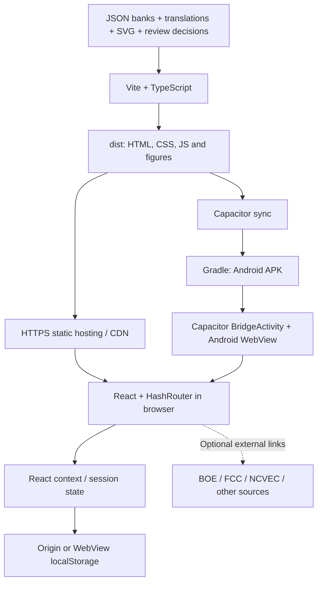

# Technical and deployment guide

**EA5KAO Ham Exam Prep · Application author: Anatol EA5KAO**

Document: 2026-10-18 · [Español](GUIA-TECNICA.es.md) · [Verified results](VALIDATION.en.md)

## 1. Scope and actual status

An educational web and Android application. The US module covers Technician,
General and Amateur Extra in English and Spanish. Spain covers Technical and
Regulations with Spanish questions and explanations; **English translations of
the Spain bank are not included**. Changing the UI language does not change that.
The app does not administer official exams, issue HAREC certificates or provide
accounts, a proprietary API, a remote database, payments or cross-device sync.

US banks total 1,431 questions (409/423/599). Spain has 1,094 questions
(578 technical, 516 regulations), 73 SVG files and 46 pending-review questions
excluded from mock exams: 578/470 eligible. The entire bank is not certified
as current official material.

## 2. Architecture



### 2.1 Components and responsibilities

| Component | Responsibility and boundaries |
|---|---|
| `src/App.tsx` | State context and `HashRouter`; the same React tree on web and Android |
| `src/pages/HomePage.tsx` | Country selection and US entry |
| `src/pages/LevelPage.tsx`, `StudyPage.tsx`, `PracticePage.tsx`, `ExamPage.tsx` | US selection and study modes |
| `src/pages/SpainPage.tsx` | Local import, study and independent Spanish exam parts |
| `src/lib/pools.ts` | Eagerly bundled US banks/translations and merged-pool cache |
| `src/lib/exam.ts`, `selection.ts` | Randomization, group selection and US scoring |
| `src/lib/spain.ts` | Schema, validation, deduplication, ID-based merge, choices and Spanish exams |
| `src/lib/explanations.ts`, `calculation-explanations.ts` | Bilingual US foundations and individual worked solutions |
| `src/lib/progress.ts` | US state, statistics and local history |
| `src/lib/comics.ts`, `src/components/QuestionComic.tsx` | Per-question Chomp & Chip episodes, original SVG artwork and watermark; only after disclosure or submission. See [scope](CHOMP-CHIP.md) |
| `scripts/import-*.mjs`, `spain-review.mjs` | Conversion, provenance and explicit reviewed data corrections |
| `public/figures/` | Packaged static resources, not third-party runtime downloads |
| `android/` | Capacitor native wrapper, manifest, icons and Gradle project |

### 2.2 Routes and execution flow

1. The server delivers `index.html` and build assets.
2. React restores US preferences and progress from `hamprep.v1`.
3. `/#/` selects a country; `/#/usa` lists levels and `/#/spain` opens Spain.
4. US routes are `/#/level/technician`, `/general` or `/extra`, with
   `/study`, `/practice` and `/exam` suffixes. Group filters travel in the hash
   route's query string.
5. Spain merges bundled data with `hamprep.spain.questions.v1`.
   Bundled IDs use the current packaged version, preventing stale keys returning.
6. A session is created in memory. Explanations appear after answering/revealing
   or grading, never as hints in an ongoing mock exam.
7. US statistics and history are persisted. Spain does not persist results or
   in-progress attempts; refreshing abandons the Spanish attempt.

`base: './'` and `HashRouter` support subdirectories and WebView without server
rewrites for internal routes. Do not treat `file://` as reliable web deployment:
serve the app over HTTP(S).

### 2.3 Domain rules

| Exam | Selection | Passing |
|---|---|---|
| Technician | 35, one per official group | 26 |
| General | 35, one per official group | 26 |
| Extra | 50, one per official group | 37 |
| US selected groups | One per selected group, or every selected question | `ceil(total × 0.74)` |
| Spain Technical | 30 distinct questions without pending review | 15; 45 minutes |
| Spain Regulations | 30 distinct questions without pending review | 15; 45 minutes |

Spain requires both parts to pass independently; scores cannot compensate for
each other and wrong answers do not subtract points. Each part has its own timer.
Spanish topic filters affect study only, never the mock exam selection.
Text choices are shuffled with the key recalculated; graphical/fixed choices
retain their original order.

US modes include practice, flashcards and correct-answer-only study.
The **implemented** mastery rule is: last attempt correct and cumulative accuracy
>=75%, not two consecutive correct answers. US history retains the latest 50 exams.

### 2.4 Persistence and isolation

- `localStorage` belongs to an origin (scheme, host, port), browser profile and device.
- Web and Android, or two web domains, do not automatically share data.
- Clearing browser data, uninstalling or changing origin can lose progress.
- Imported Spanish JSON is stored locally; imports do not upload new images.
- Import errors are displayed and invalid imports are not saved.
- Existing limitation: US progress persistence catches storage errors without
  notifying the learner. Do not promise guaranteed saving or integrated backup.
- There is no application-level encryption or authentication; storage is not
  suitable for secrets.
- Android allows backup in the manifest; effective behavior depends on the OS
  and device. It is not a verified recovery mechanism.

### 2.5 Offline behavior

Android packages JS, banks and images and supports offline study after installation.
BOE/FCC/other external links still require connectivity. The website includes a
basic `manifest.webmanifest`, but **no service worker or guaranteed precache**.
Installation as a PWA has not been verified. An already loaded tab may keep
working, but closing and reopening it offline is not guaranteed.
HTTP browser cache is not a substitute for that guarantee.

## 3. Technical requirements

### 3.1 Building and testing

| Item | Version or condition |
|---|---|
| Git | HTTPS client and repository access |
| Node.js | 22.23.3 used in verification and pinned in CI; use compatible Node 22 |
| npm | Bundled with Node 22; `npm ci` consumes `package-lock.json` |
| Frontend | React 19, React Router 7, Vite 8, TypeScript 6 |
| Testing/lint | Vitest 5 and oxlint; no additional load-testing dependencies |
| Android | Capacitor 8.5, JDK **21**, Gradle wrapper 8.14.3, AGP 8.13.0 |
| SDK | `platforms;android-36`, `build-tools;35.0.0`, `platform-tools` |
| OS | Windows for the PowerShell APK helper; Linux/macOS can invoke Gradle manually |
| Initial connectivity | npm, Gradle/Maven/Google repositories and GitHub |

Recommended build budget, not a certified minimum: 4 CPU cores, 8 GB RAM and
15 GB free space for SDK/caches; more for an emulator. No systematic minimum-device
benchmark has been performed. JDK 17 or Java 8 cannot compile this project's
Capacitor 8 Java 21 code.

### 3.2 Runtime

Web: static HTTPS hosting and a modern browser with JavaScript, SVG and
`localStorage`. Production hosting does not require Node, Java, PHP, SQL,
containers or an API. Most runtime CPU/memory usage occurs on the learner's device.

Android: `minSdk=24` (Android 7.0), `targetSdk=36`, an up-to-date WebView and
space for the APK/data. The manifest requests `INTERNET`; there are no custom
camera, location or account plugins. Declared compatibility is not physical-device
verification on every Android version.

## 4. Initial setup

```powershell
git clone https://github.com/anatolbricoham/exam.git
Set-Location exam
node --version
npm --version
npm ci
npm test
npm run lint
npm run build:public
```

Do not run `npm update` as a deployment step: it changes dependencies. Review and
commit any intended lockfile changes separately.

### 4.1 Public versus local builds

- `npm run build` retains optional locally authorized GLAARG translations.
- `npm run build:public` **always excludes** `src/data/i18n/es-glaarg/`,
  even when present locally, using the complete application-owned translations.
- `npm run android:sync:public` applies the same policy to APK assets.
- GLAARG PDFs/translations are not in Git and must not accidentally ship inside JS.
  A Git-ignored file can still enter a bundle without an explicit build policy.
- BricoHams attribution and CC BY-SA 4.0 apply to its material; SVG files and notes
  are preserved. Anatol EA5KAO authors the application, not all third-party materials.

### 4.2 Development

```powershell
npm run dev -- --host 127.0.0.1
```

Do not expose Vite to the Internet as a production service. To inspect a build:

```powershell
npm run build:public
npm run preview -- --host 127.0.0.1 --port 4183 --strictPort
```

## 5. Step-by-step web deployment

### 5.1 GitHub Pages: manual and controlled

1. Have administrative permissions and a repository plan/visibility supporting Pages.
2. Open **Settings → Pages → Build and deployment → Source: GitHub Actions**.
3. Open **Actions → Deploy web to GitHub Pages → Run workflow** on `main`.
4. The workflow installs from the lockfile, tests, lints and builds in public mode.
5. Only the deployment job receives `pages:write` and `id-token:write`.
6. Approve the `github-pages` environment if protection rules require it.
7. Use the actual workflow output URL, normally
   `https://anatolbricoham.github.io/exam/`; do not assume it is live before checking.
8. Open `/`, `/#/usa`, `/#/spain`, General and Extra; load a figure and a mock exam.
9. Record deployed commit, URL, date and acceptance-test evidence.

This delivery adds the workflow, not an automatic Pages configuration change
or a claim that the website is already live. For private repositories, check
published site visibility before enabling Pages.

### 5.2 Any static host

1. Run tests and `npm run build:public`.
2. Upload **the contents of `dist/`**, including `assets/` and `figures/`,
   not source code, `node_modules`, SDKs, keystores or user files.
3. Enable HTTPS and correct MIME types for HTML, JavaScript, CSS and `image/svg+xml`.
4. Publish atomically; keep previous-version assets while cached HTML may refer to them.
5. Use `Cache-Control: no-cache` for `index.html`; hashed assets can use
   `public,max-age=31536000,immutable`. Unhashed figures need revalidation or short TTL.
   Apply the policy consistently with gzip/Brotli compression.
6. Do not return `index.html` with HTTP 200 for missing JS/SVG: it is a content
   failure even if a shallow uptime check reports success.
7. Test hash routes, answers and figures at the final URL, not only localhost.
8. Roll back by restoring the complete previous artifact. Origin storage is
   not erased by rollback, but verify ID/schema compatibility.

Recommended headers, subject to host-specific validation:
`X-Content-Type-Options: nosniff` and
`Referrer-Policy: strict-origin-when-cross-origin`.
Test scripts, styles and links before enforcing CSP; do not copy an untested policy.

## 6. Step-by-step Android APK

### 6.1 Reproducible hosted build

1. Push to `main` or run **Actions → Android debug APK → Run workflow**.
2. The Windows runner configures Node 22.23.3 and Temurin JDK 21.
3. It checks that the runner SDK already has accepted licenses and fails otherwise.
   The workflow does not automatically accept a license.
4. It prepares API 36, Build Tools 35.0.0 and Platform Tools.
5. It runs `npm ci`, tests and lint.
6. `scripts/build-apk.ps1` creates the public build, syncs Capacitor and runs
   `assembleDebug` without a persistent daemon and with at most two workers.
7. It verifies the signature using `apksigner`, package/SDK using `aapt`, then
   SHA-256 compares **every `dist/` file** with its APK `assets/public/` entry.
8. It uploads an Actions artifact with APK, `SHA256SUMS.txt`, `build-info.json`,
   inspected manifest and web bundle. Retention: 30 days.
9. Download from a **successful** run, extract the ZIP and check the checksum.
   Private-repository artifacts may require GitHub authentication.
10. Keep a copy if needed beyond 30 days. APK binaries are not committed to Git;
    the build recipe and documentation are versioned.

For this delivery, the verified APK, checksum and `build-info.json` are also
published in the [testing prerelease](https://github.com/anatolbricoham/exam/releases/tag/v1.0.0-debug.20261018),
without the Actions 30-day expiry. Future builds only create the artifact;
publishing another prerelease is a separate step. Private-repository access is
required. See the [validation report](VALIDATION.en.md).

Do not claim **bit-for-bit** reproducibility across builds: debug certificates,
timestamps and hosted tools may change. The recipe and exact built-asset
comparison are reproducible, not necessarily identical APK bytes.

### 6.2 Local Windows build

1. Install JDK 21 and Android Studio or Android command-line tools from official
   sources. Personally review and accept SDK licenses.
2. Install API 36, Build Tools 35.0.0 and Platform Tools through SDK Manager.
3. Set variables only in the current terminal if global changes are undesirable:

```powershell
$env:JAVA_HOME = 'C:\path\to\jdk-21'
$env:ANDROID_HOME = "$env:LOCALAPPDATA\Android\Sdk"
$env:Path = "$env:JAVA_HOME\bin;$env:ANDROID_HOME\platform-tools;$env:Path"
java -version
javac -version
npm ci
npm run android:apk
```

4. Find `artifacts\android\EA5KAO-Ham-Exam-1.0.0-debug.apk`.
5. Compare `(Get-FileHash ... -Algorithm SHA256).Hash` with `SHA256SUMS.txt`.

The helper targets Windows and requires explicit `JAVA_HOME`. `-SkipWebBuild`
is only for diagnostics with already-synced assets; stale assets fail comparison.
Do not use it for a normal delivery.

### 6.3 Device installation and acceptance

```powershell
adb devices
adb install -r '.\artifacts\android\EA5KAO-Ham-Exam-1.0.0-debug.apk'
adb shell am start -n com.hamexamprep.app/.MainActivity
```

Alternatively transfer the APK, verify its source and temporarily allow installs
from that source. Do not disable device-wide protections. Test:

- Country selection, languages and Technician/General/Extra loading.
- Practice, hidden/revealed flashcards, zoomable figures and correct keys.
- Spain pending warnings, post-reveal references, 30 questions, independent timers
  and passing exactly at 15.
- Airplane mode after installation: banks and local figures still available.
- Rotation, Back button, small screens and background/resume.
- Restart and US persistence; refreshing Spain abandons its session.

A debug APK is debuggable and uses a development certificate. Different runners
may produce different debug keys. If updating returns
`INSTALL_FAILED_UPDATE_INCOMPATIBLE`, **do not uninstall without preserving data
and obtaining the user's consent**: uninstalling may erase progress. Use an
owner-controlled stable key for persistent testing.

### 6.4 Signed release and Google Play: not performed

1. The owner creates/selects a release key or Google Play App Signing setup and
   keeps secure backups outside the repository.
2. Increment `versionCode` for every release and align product version metadata.
   Android currently uses 1/`1.0`; npm uses `1.0.0`.
3. Run `npm run android:sync:public`, then `npm run android:open`.
4. Select **Build → Generate Signed Bundle / APK**, choose APK or AAB and the
   owner's key. Do not use debug signing, passwords in command-line arguments,
   or signing files committed to Git.
5. Verify release signature, manifest, assets and actual devices; generate a
   checksum and record commit, version and public certificate identity.
6. Complete Play Console listing, privacy/Data Safety, content rating, material
   rights, access and account-specific testing requirements.
7. Check target API and store policies effective on the publication date.
8. Distribute through internal testing first, promote after acceptance and plan
   recovery. An AAB cannot be installed directly with `adb install`.

This delivery does not configure automatic release signing or publish an AAB.
An existing debug keystore is not an authorized production signing key.

## 7. Data and maintenance processes

### 7.1 US banks

1. Verify validity against NCVEC/FCC/ARRL.
2. Review `POOLS` in `scripts/import-pools.mjs`; run `npm run import-pools`.
3. Review diffs, errata, groups, answer keys and figure paths.
4. Update application-owned translations in the same choice order as English.
5. `npm run import-glaarg` is optional and local; it does not grant redistribution rights.
6. Run bank, translation and explanation tests before producing the public build.

### 7.2 Spain

1. Preserve the authorized source package and its license outside Git where appropriate.
2. Run `npm run import-bricohams -- "C:\path\BricoHams_banco_preguntas"`.
3. SHA-256 must match the reviewed package; another package fails explicitly
   instead of applying old corrections blindly.
4. Review each `scripts/spain-review.mjs` decision, BOE reference and validity.
   Do not remove `reviewReason` merely to increase exam coverage.
5. Regenerate bank/report; the report preserves originals of reviewed questions.
6. Check deduplication by part, stem, graphical context and correct answer.
   Contradictory keys and reused IDs raise explicit errors.
7. Review counts, tests, licenses and Android synchronization.

In-app Spanish import: confirm rights, choose JSON, validate and save locally.
This does not upload to Git or deploy to other learners. The root README
documents the complete import schema.

## 8. Workload simulation

### 8.1 What is measured

There is no session backend. Remote workload is static-file delivery. Exams
and scoring execute on the client; HTTP concurrent users do not represent
React/WebView CPU or memory use.

`scripts/load-test.mjs` uses Node `fetch`, without extra dependencies:

- `cold-visit`: HTML, all built JS/CSS and two Spanish figures, sequentially
  per session, without a browser cache.
- `figure-navigation`: requests the two figures to represent content fetching
  with JS already resident; **it does not execute React navigation or answers**.
- Defaults: 30 sessions per stage at concurrency 1, 5 and 20, for six stages.
- Closed-loop model: each worker starts another session after finishing; not
  an open arrival-rate generator or 20 real people studying for 45 minutes.
- Checks HTTP 200 and SHA-256 against `dist/`, detecting HTML fallback or assets
  from another deployment. Errors/timeouts remain explicit.
- Records request p50/p95/p99, session p95, decompressed bytes and requests/second.
  Request time includes download, buffering and hash verification.
- Default local acceptance threshold: zero failures and p95 <=2,000 ms per stage.
  Threshold failure still writes the report, then returns a nonzero exit status.

### 8.2 Reproduction

Terminal 1:

```powershell
npm run build:public
npm run preview -- --host 127.0.0.1 --port 4183 --strictPort
```

Terminal 2:

```powershell
npm run load:test -- --base-url http://127.0.0.1:4183/ --concurrency 1,5,20 --sessions 30 --max-p95-ms 2000 --output artifacts\load\results.json
```

Stop preview with Ctrl+C. `vite preview` is not a production server.
Remote targets are refused by default. Only with the target operator's permission:

```powershell
npm run load:test -- --base-url https://staging.example.org/exam/ --allow-remote --concurrency 1,5 --sessions 10
```

The target must serve the exact local `dist/`. Do not embed credentials in the
URL or test unauthorized systems. Generator limits: concurrency <=100, sessions
per stage <=10,000. Start small.

### 8.3 Sizing and limitations

For compressed visit size `B` and new visits/second `R`, approximate traffic is
`B × R`; multiply bytes/s by `8/1,000,000` for Mbps.
**Hypothetical example**, not a measurement: 0.55 MB/visit ×10 visits/s ≈44 Mbps,
excluding headers and extra images. Use actual host transfer sizes, not the
report's decompressed bytes as though they were Brotli/gzip traffic.

Production evaluation must include TLS, WAN, cold/warm CDN, slow mobile devices,
low memory, time to interaction, full download and actual errors. Eagerly bundled
banks intentionally increase initial size to avoid broken dynamic bank loads.
Vite's >500 kB chunk warning is not a build failure. Localhost results do not
certify maximum learners or an SLA.

## 9. Operations, privacy and recovery

- No application server needs restarting and no central learner database needs migration.
- Monitor HTTPS, certificate expiry, actual HTML/JS/SVG content and bandwidth,
  not just HTTP 200.
- Record commit, CI result, APK hash and bank version for each delivery.
- Review dependencies, errata and regulations before updating. `npm audit` is
  useful dependency information, not a full security audit.
- Never include tokens, accounts, keystores, passwords or learner profiles in logs.
- No proprietary analytics or telemetry backend exists; the static host may still
  log IP addresses and requests. Review its retention/privacy policy.
- Questions and answer keys are inspectable client-side; this app is not suitable
  for supervised exams requiring secret answer keys.
- External references can change. An inaccessible link is not evidence that
  an answer is valid or invalid.
- Keep authorized sources and build artifacts. There is no integrated progress
  export/restore feature; do not promise recovery after data deletion.

## 10. Troubleshooting

| Symptom | Check and action |
|---|---|
| Java 8/17, `invalid source release: 21` | Select JDK 21 using `JAVA_HOME`/Gradle JDK without changing unrelated projects |
| `SDK location not found` | Set `ANDROID_HOME` or local `android/local.properties`; do not commit developer-specific paths |
| SDK license missing | Owner must read/accept it; never fabricate accepted-license files |
| Missing API 36/Build Tools | Install the documented packages |
| Maven/npm inaccessible | Check proxy, TLS and connectivity; do not disable certificate validation |
| Blank page after update | Check matching HTML/JS versions, cache and `assets/` paths; use atomic rollback |
| General/Extra missing | Inspect bundle and console; banks are bundled and do not depend on an API |
| GLAARG wording in public build | Rebuild with `build:public`; do not publish a local build |
| Lost progress | Check origin/profile, permissions and storage quota; do not clear data first |
| `INSTALL_FAILED_UPDATE_INCOMPATIBLE` | Certificate mismatch; no uninstall without consent and preservation |
| Spanish import error | Check four choices, 0..3 key, IDs, duplicates and allowed local image paths |
| Load test fails despite HTTP 200 | Compare hashes: HTML fallback or different deployment |
| No Actions artifact | Inspect failed step; successful web compilation alone is not a compiled APK |

## 11. Delivery checklist

- [ ] Redistribution rights and public build mode confirmed.
- [ ] `npm ci`, tests, lint and build passed.
- [ ] US/Spain banks, pending warnings and figures checked.
- [ ] Load simulation includes date, environment, thresholds and limitations.
- [ ] APK assembled; signature, manifest, assets and checksum verified.
- [ ] Device testing status disclosed honestly.
- [ ] Final web URL tested if deployed; Pages activation is not assumed.
- [ ] No secrets, private signing keys or learner data in Git/artifacts.
- [ ] Commit/artifact identified, retention and rollback defined.

## 12. Tool references

- [Capacitor Android](https://capacitorjs.com/docs/android)
- [Android SDK/tools](https://developer.android.com/tools)
- [SDK license](https://developer.android.com/studio/terms)
- [App signing](https://developer.android.com/studio/publish/app-signing)
- [Custom GitHub Pages workflows](https://docs.github.com/en/pages/getting-started-with-github-pages/using-custom-workflows-with-github-pages)
- [Actions artifacts](https://docs.github.com/en/actions/using-workflows/storing-workflow-data-as-artifacts)

The built commit's configuration and lockfile determine actual versions,
not generic requirements in an external guide.
